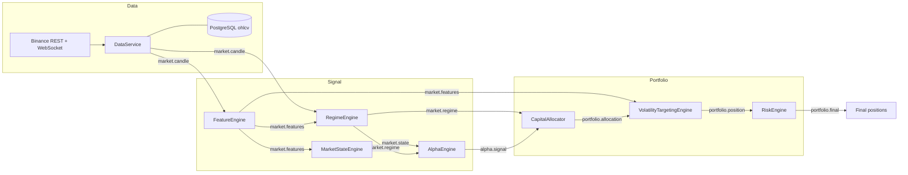

<div align="center">

# Alpha Engine

**An event-driven, regime-adaptive, multi-alpha research and trading engine for crypto markets.**

[](https://github.com/Divyansh151005/alpha-engine/actions/workflows/tests.yml)


[](LICENSE)

</div>

---

Alpha Engine turns raw Binance candles into risk-managed portfolio targets through a chain of small, independent engines that talk only over an in-process event bus:

> **candles** &rarr; **features** &rarr; **market regime + normalized state** &rarr; **alpha signals** &rarr; **capital allocation** &rarr; **volatility targeting** &rarr; **drawdown control** &rarr; **final positions**

The same feature, state, and alpha code is reused by live data ingestion, a cost-aware backtester, a paper-trading loop, and a set of research and validation scripts, so research results come from the exact logic that runs live.

## Table of contents

- [Key features](#key-features)
- [Alpha strategy catalog](#alpha-strategy-catalog)
- [Architecture](#architecture)
- [Project structure](#project-structure)

## Key features

| | Feature | What it does |
|---|---|---|
| :satellite: | **Market data engine** | Paged Binance OHLCV history via `ccxt`, a live kline WebSocket stream, and PostgreSQL persistence. Also pulls USDT-M perpetual **funding rates** and **open interest** and aligns them to bars. |
| :bar_chart: | **Feature engine** | 20+ per-bar features: realized vol, ATR, trend strength, multi-horizon returns, return z-score, volume spike, wick ratios, Bollinger distance, range compression/expansion, momentum acceleration. |
| :compass: | **Regime detection** | Classifies every bar as `TREND`, `MEAN_REVERSION`, `HIGH_VOL`, or `LOW_VOL` and reweights strategy families accordingly. |
| :brain: | **Multi-alpha engine** | Eight independent strategies emit scores in `[-1, 1]`. They are filtered, AND-gated where paired, and combined into an EMA-smoothed net signal that is never allowed to flip the raw direction. |
| :scales: | **Allocation and sizing** | Regime-weighted capital allocation followed by volatility targeting (`target_vol / realized_vol`, floored and bounded). |
| :shield: | **Risk engine** | Deterministic drawdown ladder (1.0x / 0.8x / 0.5x / 0.2x) with a hard **kill switch** at 20% drawdown. |
| :hourglass: | **Overtrading controls** | Volatility-aware signal threshold, per-strategy cooldown, trade-frequency cap, minimum holding period, and a discrete position manager. |
| :test_tube: | **Cost-aware backtester** | Fees (4 bps) and slippage (2 bps), a top-decile signal-rank gate, a regime exposure band, an optional HIGH_VOL execution filter, and 20+ reported metrics. |
| :microscope: | **Research tooling** | Scripts for signal research with p-values, multi-window and multi-symbol robustness validation, filter A/B comparison, and paper trading. |

## Alpha strategy catalog

All strategies live in [`alpha_engine/alpha/`](alpha_engine/alpha) and implement `BaseAlphaStrategy`. Positive score means long, negative means short.

| Strategy | Family | Signal logic |
|---|---|---|
| `TrendAlphaStrategy` | Trend | Weighted multi-timeframe momentum (`0.5*r5 + 0.3*r10 + 0.2*r20`), volatility-normalized, then averaged with EMA-crossover strength and the normalized trend state, clipped to `[-1, 1]`. |
| `MeanReversionAlphaStrategy` | Mean reversion | Fades stretched moves: return z-score above `+2` goes short, below `-2` goes long. |
| `BreakoutAlphaStrategy` | Breakout | Fires in the direction of the bar when `abs(latest return)` exceeds 2x the 20-bar return volatility. |
| `MomentumPersistenceAlphaStrategy` | Momentum | Short-only: three consecutive negative bar returns give a full short. |
| `VolumeSpikeAlphaStrategy` | Volume | `volume / SMA20(volume)` above 2.0 is long, below 0.5 is short, otherwise flat. |
| `FundingContrarianAlphaStrategy` | Funding | Negated rolling z-score of perpetual funding (default 168-bar window): crowded longs lead to a short tilt, crowded shorts to a long tilt. |
| `FundingPriceConfirmContrarianAlphaStrategy` | Funding + price | Requires an extreme funding score **and** an agreeing 10-bar return, with optional `abs(r20)` regime band, adaptive percentile funding-structure gates, and sign-persistence checks. Per-asset overrides live in `funding_asset_config.py`. |
| `PriceDivergenceContrarianConfirmAlphaStrategy` | Confirmation | Second leg of the funding thesis. When registered with the funding contrarian, `AlphaEngine` only lets the pair trade if **both** agree. |

## Architecture

Every component subscribes to topics on a shared `EventBus`, does one job, and publishes its result on a new topic. Nothing calls anything else directly, so each layer can be replaced, disabled, or unit-tested by publishing synthetic events.



| Engine | Package | Responsibility |
|---|---|---|
| Data | `data_engine/`, `data/` | Fetch, stream, and store candles; fetch and align funding and open interest. |
| Features | `features/` | Rolling technical and microstructure features per bar. |
| Regime | `regime/` | `TREND` / `MEAN_REVERSION` / `HIGH_VOL` / `LOW_VOL` from trend strength, vol ratio, and lag-1 autocorrelation. |
| Market state | `state_engine/` | Normalize features into a `[0, 1]` state vector plus the raw signed fields strategies need. |
| Alpha | `alpha/` | Run strategies, filter weak signals, gate paired strategies, smooth the net signal. |
| Filters | `filters/` | Signal threshold, cooldown, and trade-frequency limits. |
| Allocation | `allocation_engine/` | Turn signals into capital fractions and reweight them by regime. |
| Volatility targeting | `volatility_engine/` | Scale exposure toward a target volatility. |
| Risk | `risk_engine/` | Drawdown ladder and kill switch. |
| Position | `position/` | Discrete `-1 / 0 / +1` position state with hold and flip rules. |
| Backtest | `backtest/` | Replay candles through the stack with costs and execution gates. |

**Regime weights** applied by the allocator:

| Regime | Trend | Breakout | Mean reversion |
|---|:-:|:-:|:-:|
| `TREND` | 1.3 | 1.2 | 0.6 |
| `MEAN_REVERSION` | 0.6 | 0.8 | 1.3 |
| `HIGH_VOL` | 0.7 | 0.7 | 0.7 |
| `LOW_VOL` | 1.0 | 0.6 | 1.0 |

**Drawdown ladder** applied by the risk engine:

| Drawdown | under 5% | 5% or more | 10% or more | 15% or more | 20% or more |
|---|:-:|:-:|:-:|:-:|:-:|
| Exposure multiplier | 1.0 | 0.8 | 0.5 | 0.2 | **0.0 (kill switch)** |

The full topic contract and per-module notes are in [`docs/ARCHITECTURE.md`](docs/ARCHITECTURE.md).

## Project structure

```text
alpha-engine/
├── main.py                       # Wires the full event pipeline, bootstraps BTC/USDT 1m history, runs a backtest
├── requirements.txt
├── pyproject.toml                # Project metadata and pytest config
├── .env.example                  # Template for database and runtime settings
├── docs/
│   └── ARCHITECTURE.md           # Event topic contract and module notes
├── scripts/                      # Research, validation, and paper-trading entry points
└── alpha_engine/
    ├── core/                     # EventBus, pydantic Settings, logger, global state
    ├── data_engine/              # Binance REST client, WebSocket stream, Postgres storage, schema.sql
    ├── data/                     # OHLCV model, funding-rate and open-interest fetch and alignment
    ├── features/                 # FeatureEngine plus trend, volatility, microstructure helpers
    ├── regime/                   # RegimeEngine and regime weight multipliers
    ├── state_engine/             # MarketStateEngine and MarketStateVector
    ├── alpha/                    # AlphaEngine, AlphaSignal, and the 8 strategies
    ├── filters/                  # SignalFilter, CooldownTracker, TradeFrequencyTracker
    ├── allocation_engine/        # CapitalAllocator and PositionAllocation
    ├── volatility_engine/        # VolatilityTargetingEngine
    ├── risk_engine/              # RiskEngine, RiskState, drawdown ladder
    ├── position/                 # PositionManager (discrete -1/0/+1 positions)
    ├── backtest/                 # BacktestEngine, metrics, cost model
    ├── strategies/ allocation/ risk/ execution/   # Abstract interfaces for pluggable layers
    └── tests/                    # 135 pytest tests across 18 modules
```
