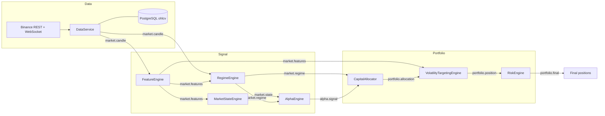

<div align="center">

# Alpha Engine

**An event-driven, regime-adaptive, multi-alpha research and trading engine for crypto markets.**

[](https://github.com/Divyansh151005/alpha-engine/actions/workflows/tests.yml)


[](LICENSE)

</div>

---

Alpha Engine turns raw Binance candles into risk-managed portfolio targets through a chain of small, independent engines that talk only over an in-process event bus:

> **candles** &rarr; **features** &rarr; **market regime + normalized state** &rarr; **alpha signals** &rarr; **capital allocation** &rarr; **volatility targeting** &rarr; **drawdown control** &rarr; **final positions**

The same feature, state, and alpha code is reused by live data ingestion, a cost-aware backtester, a paper-trading loop, and a set of research and validation scripts, so research results come from the exact logic that runs live.

## Table of contents

- [Key features](#key-features)
- [Alpha strategy catalog](#alpha-strategy-catalog)
- [Architecture](#architecture)
- [Project structure](#project-structure)
- [Quickstart](#quickstart)
- [Research and validation scripts](#research-and-validation-scripts)
- [Configuration](#configuration)
- [Testing](#testing)
- [Roadmap](#roadmap)
- [Disclaimer](#disclaimer)

## Key features

| | Feature | What it does |
|---|---|---|
| :satellite: | **Market data engine** | Paged Binance OHLCV history via `ccxt`, a live kline WebSocket stream, and PostgreSQL persistence. Also pulls USDT-M perpetual **funding rates** and **open interest** and aligns them to bars. |
| :bar_chart: | **Feature engine** | 20+ per-bar features: realized vol, ATR, trend strength, multi-horizon returns, return z-score, volume spike, wick ratios, Bollinger distance, range compression/expansion, momentum acceleration. |
| :compass: | **Regime detection** | Classifies every bar as `TREND`, `MEAN_REVERSION`, `HIGH_VOL`, or `LOW_VOL` and reweights strategy families accordingly. |
| :brain: | **Multi-alpha engine** | Eight independent strategies emit scores in `[-1, 1]`. They are filtered, AND-gated where paired, and combined into an EMA-smoothed net signal that is never allowed to flip the raw direction. |
| :scales: | **Allocation and sizing** | Regime-weighted capital allocation followed by volatility targeting (`target_vol / realized_vol`, floored and bounded). |
| :shield: | **Risk engine** | Deterministic drawdown ladder (1.0x / 0.8x / 0.5x / 0.2x) with a hard **kill switch** at 20% drawdown. |
| :hourglass: | **Overtrading controls** | Volatility-aware signal threshold, per-strategy cooldown, trade-frequency cap, minimum holding period, and a discrete position manager. |
| :test_tube: | **Cost-aware backtester** | Fees (4 bps) and slippage (2 bps), a top-decile signal-rank gate, a regime exposure band, an optional HIGH_VOL execution filter, and 20+ reported metrics. |
| :microscope: | **Research tooling** | Scripts for signal research with p-values, multi-window and multi-symbol robustness validation, filter A/B comparison, and paper trading. |

## Alpha strategy catalog

All strategies live in [`alpha_engine/alpha/`](alpha_engine/alpha) and implement `BaseAlphaStrategy`. Positive score means long, negative means short.

| Strategy | Family | Signal logic |
|---|---|---|
| `TrendAlphaStrategy` | Trend | Weighted multi-timeframe momentum (`0.5*r5 + 0.3*r10 + 0.2*r20`), volatility-normalized, then averaged with EMA-crossover strength and the normalized trend state, clipped to `[-1, 1]`. |
| `MeanReversionAlphaStrategy` | Mean reversion | Fades stretched moves: return z-score above `+2` goes short, below `-2` goes long. |
| `BreakoutAlphaStrategy` | Breakout | Fires in the direction of the bar when `abs(latest return)` exceeds 2x the 20-bar return volatility. |
| `MomentumPersistenceAlphaStrategy` | Momentum | Short-only: three consecutive negative bar returns give a full short. |
| `VolumeSpikeAlphaStrategy` | Volume | `volume / SMA20(volume)` above 2.0 is long, below 0.5 is short, otherwise flat. |
| `FundingContrarianAlphaStrategy` | Funding | Negated rolling z-score of perpetual funding (default 168-bar window): crowded longs lead to a short tilt, crowded shorts to a long tilt. |
| `FundingPriceConfirmContrarianAlphaStrategy` | Funding + price | Requires an extreme funding score **and** an agreeing 10-bar return, with optional `abs(r20)` regime band, adaptive percentile funding-structure gates, and sign-persistence checks. Per-asset overrides live in `funding_asset_config.py`. |
| `PriceDivergenceContrarianConfirmAlphaStrategy` | Confirmation | Second leg of the funding thesis. When registered with the funding contrarian, `AlphaEngine` only lets the pair trade if **both** agree. |

## Architecture

Every component subscribes to topics on a shared `EventBus`, does one job, and publishes its result on a new topic. Nothing calls anything else directly, so each layer can be replaced, disabled, or unit-tested by publishing synthetic events.



| Engine | Package | Responsibility |
|---|---|---|
| Data | `data_engine/`, `data/` | Fetch, stream, and store candles; fetch and align funding and open interest. |
| Features | `features/` | Rolling technical and microstructure features per bar. |
| Regime | `regime/` | `TREND` / `MEAN_REVERSION` / `HIGH_VOL` / `LOW_VOL` from trend strength, vol ratio, and lag-1 autocorrelation. |
| Market state | `state_engine/` | Normalize features into a `[0, 1]` state vector plus the raw signed fields strategies need. |
| Alpha | `alpha/` | Run strategies, filter weak signals, gate paired strategies, smooth the net signal. |
| Filters | `filters/` | Signal threshold, cooldown, and trade-frequency limits. |
| Allocation | `allocation_engine/` | Turn signals into capital fractions and reweight them by regime. |
| Volatility targeting | `volatility_engine/` | Scale exposure toward a target volatility. |
| Risk | `risk_engine/` | Drawdown ladder and kill switch. |
| Position | `position/` | Discrete `-1 / 0 / +1` position state with hold and flip rules. |
| Backtest | `backtest/` | Replay candles through the stack with costs and execution gates. |

**Regime weights** applied by the allocator:

| Regime | Trend | Breakout | Mean reversion |
|---|:-:|:-:|:-:|
| `TREND` | 1.3 | 1.2 | 0.6 |
| `MEAN_REVERSION` | 0.6 | 0.8 | 1.3 |
| `HIGH_VOL` | 0.7 | 0.7 | 0.7 |
| `LOW_VOL` | 1.0 | 0.6 | 1.0 |

**Drawdown ladder** applied by the risk engine:

| Drawdown | under 5% | 5% or more | 10% or more | 15% or more | 20% or more |
|---|:-:|:-:|:-:|:-:|:-:|
| Exposure multiplier | 1.0 | 0.8 | 0.5 | 0.2 | **0.0 (kill switch)** |

The full topic contract and per-module notes are in [`docs/ARCHITECTURE.md`](docs/ARCHITECTURE.md).

## Project structure

```text
alpha-engine/
├── main.py                       # Wires the full event pipeline, bootstraps BTC/USDT 1m history, runs a backtest
├── requirements.txt
├── pyproject.toml                # Project metadata and pytest config
├── .env.example                  # Template for database and runtime settings
├── docs/
│   └── ARCHITECTURE.md           # Event topic contract and module notes
├── scripts/                      # Research, validation, and paper-trading entry points
└── alpha_engine/
    ├── core/                     # EventBus, pydantic Settings, logger, global state
    ├── data_engine/              # Binance REST client, WebSocket stream, Postgres storage, schema.sql
    ├── data/                     # OHLCV model, funding-rate and open-interest fetch and alignment
    ├── features/                 # FeatureEngine plus trend, volatility, microstructure helpers
    ├── regime/                   # RegimeEngine and regime weight multipliers
    ├── state_engine/             # MarketStateEngine and MarketStateVector
    ├── alpha/                    # AlphaEngine, AlphaSignal, and the 8 strategies
    ├── filters/                  # SignalFilter, CooldownTracker, TradeFrequencyTracker
    ├── allocation_engine/        # CapitalAllocator and PositionAllocation
    ├── volatility_engine/        # VolatilityTargetingEngine
    ├── risk_engine/              # RiskEngine, RiskState, drawdown ladder
    ├── position/                 # PositionManager (discrete -1/0/+1 positions)
    ├── backtest/                 # BacktestEngine, metrics, cost model
    ├── strategies/ allocation/ risk/ execution/   # Abstract interfaces for pluggable layers
    └── tests/                    # 135 pytest tests across 17 modules
```

## Quickstart

### Prerequisites

- Python 3.10 or newer
- PostgreSQL (only needed for `main.py` and live ingestion; tests and most scripts do not need it)
- Internet access to Binance public endpoints (no API key required for market data)

### 1. Install

```bash
git clone https://github.com/Divyansh151005/alpha-engine.git
cd alpha-engine
python -m venv .venv && source .venv/bin/activate
pip install -r requirements.txt
```

### 2. Configure

```bash
cp .env.example .env   # then edit the DB_* values
```

### 3. Create the database

```bash
createuser alpha_user --pwprompt
createdb alpha_engine --owner alpha_user
```

The `ohlcv` table is created automatically on startup from [`alpha_engine/data_engine/schema.sql`](alpha_engine/data_engine/schema.sql).

### 4. Run the pipeline

```bash
python main.py
```

`main.py` wires every engine onto one event bus, bootstraps the last 300 one-minute `BTC/USDT` candles into Postgres, streams them through the pipeline, and then runs a backtest sanity check that prints:

```text
Backtest metrics:
  total_return: ...
  sharpe_ratio: ...
  trade_count: ...
  avg_position_size: ...
  time_in_market: ...%
  turnover: ...
  total_cost: ...
  cost_impact: ...
```

### Use the pipeline in your own code

```python
from alpha_engine.core.event_bus import EventBus
from alpha_engine.features import FeatureEngine
from alpha_engine.regime import RegimeEngine
from alpha_engine.state_engine import MarketStateEngine
from alpha_engine.alpha import AlphaEngine, TrendAlphaStrategy, MeanReversionAlphaStrategy
from alpha_engine.filters import SignalFilter

bus = EventBus()
FeatureEngine(event_bus=bus)
RegimeEngine(event_bus=bus)
MarketStateEngine(event_bus=bus)
AlphaEngine(
    event_bus=bus,
    strategies=[TrendAlphaStrategy(), MeanReversionAlphaStrategy()],
    signal_filter=SignalFilter(),
)

bus.subscribe("alpha.signal", lambda s: print(s.strategy_name, s.score))

for candle in candles:  # list[OHLCV]
    bus.publish("market.candle", candle)
```

> [!TIP]
> The engines log every event at `INFO`, including `[TRACE]` lines. Set `LOG_LEVEL=WARNING` in `.env` for quiet runs.

## Research and validation scripts

Every script in [`scripts/`](scripts) reuses the production engines. Apart from `backtest_validation.py`, which runs on synthetic candles, they all pull public Binance data, and none of them need Postgres.

| Script | Purpose |
|---|---|
| [`backtest_validation.py`](scripts/backtest_validation.py) | Offline smoke test. Replays synthetic uptrend candles through `BacktestEngine` with the overtrading filters and prints turnover, cost, trade count, return, Sharpe, and drawdown. |
| [`signal_research.py`](scripts/signal_research.py) | Standalone signal lab. Correlates candidate signals (vol expansion, mean reversion, RSI, volume spike, short-term and delayed reversal, momentum persistence, cross-asset ratio momentum, funding z-score) with forward returns or forward realized volatility, and reports one-sided p-values. |
| [`funding_backtest_validation.py`](scripts/funding_backtest_validation.py) | Funding-contrarian backtests with optional price confirmation, per-asset configuration, regime and funding-structure gates (static or adaptive percentile), multi-symbol runs, and older-vs-recent robustness splits. |
| [`production_validation.py`](scripts/production_validation.py) | Replays the unchanged engine across multiple time windows, offsets, and symbols (BTC/USDT, ETH/USDT) and summarizes per-trade return distributions. |
| [`vol_filter_compare.py`](scripts/vol_filter_compare.py) | A/B test of the HIGH_VOL execution filter on identical candles and an identical alpha stack. |
| [`paper_trade_runner.py`](scripts/paper_trade_runner.py) | Paper-trading loop. Every minute it refreshes a rolling window of ETH/USDT 1h bars with funding, replays the funding + price-confirm strategy, and logs decisions to `logs/paper_trade_ETH_USDT.log`. |

```bash
# Offline sanity check (no network needed)
python scripts/backtest_validation.py

# Which signals actually predict the next 5 bars?
python scripts/signal_research.py --symbol BTC/USDT --timeframe 15m --limit 3000 --horizon 5

# Funding contrarian + price confirmation with adaptive funding gates and a robustness split
python scripts/funding_backtest_validation.py --timeframe 1h --funding-regime-adaptive --robustness-split

# Multi-window, multi-symbol robustness
python scripts/production_validation.py
```

## Configuration

Runtime settings are loaded from environment variables or `.env` by [`alpha_engine/core/config.py`](alpha_engine/core/config.py) (pydantic `BaseSettings`).

| Variable | Default | Description |
|---|---|---|
| `EXCHANGE_NAME` | `binance` | Exchange identifier |
| `DEFAULT_SYMBOL` | `BTCUSDT` | Default trading symbol |
| `BASE_RISK_PER_TRADE` | `0.01` | Base fraction of equity risked per trade |
| `TARGET_ANNUAL_VOL` | `0.2` | Annualized volatility target |
| `MAX_DRAWDOWN` | `0.15` | Maximum tolerated drawdown |
| `DB_HOST` / `POSTGRES_HOST` | `localhost` | PostgreSQL host |
| `DB_PORT` / `POSTGRES_PORT` | `5432` | PostgreSQL port |
| `DB_NAME` / `POSTGRES_DB` | `postgres` | Database name |
| `DB_USER` / `POSTGRES_USER` | `postgres` | Database user |
| `DB_PASSWORD` / `POSTGRES_PASSWORD` | empty | Database password |
| `LOG_LEVEL` | `INFO` | Python logging level |

When both are set, the `POSTGRES_*` variables take precedence over `DB_*`.

Backtest behaviour is configured in code through `BacktestEngine(...)` keyword arguments. The main ones are `fee_rate` (`0.0004`), `slippage_rate` (`0.0002`), `min_signal_threshold`, `cooldown_candles`, `max_trades_per_100_steps`, `min_holding_period`, and `vol_regime_filter`.

## Testing

```bash
python -m pytest
```

The suite has 135 tests and runs in seconds. It needs no database or network, because every engine is exercised by publishing synthetic events onto an isolated `EventBus`. Coverage includes:

- event bus fan-out and handler isolation, config loading, logging
- data engine bootstrap, storage, and open-interest alignment
- feature, market-state, and regime classification correctness
- each alpha strategy, funding + price-confirm gating, and multi-alpha diversification (pairwise strategy correlation below 0.7)
- allocation, volatility-targeting bounds, the drawdown ladder, and the kill switch
- position-manager hold and flip rules, filters, and backtest metrics

CI runs the suite on Python 3.10, 3.11, and 3.12 for every push and pull request ([workflow](.github/workflows/tests.yml)).

## Roadmap

The engine was built phase by phase. Each phase below matches a commit in the history.

- [x] **Phase 0**: Core skeleton with event bus, typed config, logging, base interfaces, and tests
- [x] **Phase 1**: Binance data engine with historical fetch, WebSocket stream, PostgreSQL storage, and event publishing
- [x] **Phase 2**: Feature engine with volatility, trend, and microstructure indicators
- [x] **Phase 3**: Market state engine that normalizes features into state signals
- [x] **Phase 5**: Dynamic capital allocation with signal weighting
- [x] **Phase 6**: Volatility-targeting position sizing
- [x] **Phase 7**: Risk engine with drawdown deleveraging and a kill switch
- [x] **Phase 9.7**: Directionally balanced multi-alpha system with strengthened mean reversion and long/short symmetry
- [x] Ranking gate, persistence filter, and symmetric execution
- [x] Funding-contrarian alpha with price-divergence confirmation and regime-based sizing
- [x] Adaptive percentile-based volatility and funding filters with open-interest regime data
- [ ] Live order execution behind `BaseExecutionEngine`
- [ ] Open-interest and order-book imbalance as first-class alpha inputs
- [ ] Persisted backtest results and a reporting dashboard

## Disclaimer

> [!WARNING]
> This project is for research and educational purposes only. It is **not** financial advice. Trading crypto derivatives carries substantial risk of loss. Backtest results are not a guarantee of future performance. Use at your own risk.

## License

Released under the [MIT License](LICENSE).

<div align="center">
<sub>Built by <a href="https://github.com/Divyansh151005">Divyansh Barodiya</a></sub>
</div>
