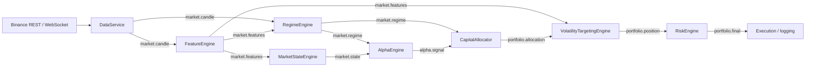

# Alpha Engine Architecture

Alpha Engine is built around a single in-process publish/subscribe bus
(`alpha_engine/core/event_bus.py`). Every engine subscribes to one or more
topics, does one job, and publishes its output on a new topic. No engine calls
another directly, so any layer can be swapped, disabled, or tested in isolation
by publishing synthetic events onto a fresh `EventBus`.

## Event pipeline

## Topic contract

| Topic | Publisher | Payload |
|---|---|---|
| `market.candle` | `DataService`, `BinanceWebSocketStream`, `BacktestEngine` | `OHLCV` |
| `market.candle.stored` | `DataService` | `OHLCV` after it has been persisted |
| `market.features` | `FeatureEngine` | `FeatureVector` |
| `market.regime` | `RegimeEngine` | `RegimeState` |
| `market.state` | `MarketStateEngine` | `MarketStateVector` |
| `alpha.signal` | `AlphaEngine` | `AlphaSignal` (one per strategy) |
| `alpha.signals` | `AlphaEngine` | `dict[str, AlphaSignal]` snapshot of the latest gated signals |
| `alpha.net_signal` | `AlphaEngine` | `float` smoothed net score |
| `portfolio.allocation` | `CapitalAllocator` | `list[PositionAllocation]` |
| `portfolio.position` | `VolatilityTargetingEngine` | `list[PositionAllocation]` after vol scaling |
| `portfolio.final` | `RiskEngine` | `list[PositionAllocation]` after drawdown scaling |

## Modules

### Core (`alpha_engine/core`)
- `event_bus.py`: multi-handler pub/sub keyed by topic string.
- `config.py`: pydantic `Settings` loaded from environment / `.env`, cached by `get_settings()`.
- `logger.py`: shared logger factory; level controlled by `LOG_LEVEL`.
- `state.py`: `GlobalState` shared runtime state model.

### Data (`alpha_engine/data_engine`, `alpha_engine/data`)
- `BinanceHistoricalClient`: paged OHLCV history through `ccxt`.
- `BinanceWebSocketStream`: live kline stream that publishes `market.candle`.
- `PostgresStorage`: persists candles into the `ohlcv` table (`schema.sql`, primary key `symbol, timeframe, timestamp`). Connects with a DSN or `POSTGRES_*` / `DB_*` variables.
- `DataService`: bootstraps history into storage and republishes candles on the bus.
- `data/funding_rates.py`: USDT-M perpetual funding history, bar alignment, contrarian z-score helpers.
- `data/open_interest.py`: USDT-M open interest fetch, as-of alignment to bars, and `oi_change` series.

### Features (`alpha_engine/features`)
`FeatureEngine` keeps rolling candle buffers and computes a `FeatureVector`
per bar: realized vol, ATR, trend strength, momentum, range compression,
volume spike, return z-score, wick ratios, 5/10/20-bar rolling returns,
volatility breakout, momentum acceleration, mean-reversion strength,
Bollinger distance, and range expansion. Helpers are split into `trend.py`,
`volatility.py`, and `microstructure.py`.

### Regime (`alpha_engine/regime`)
`RegimeEngine` classifies each bar as `TREND`, `MEAN_REVERSION`, `HIGH_VOL`,
or `LOW_VOL` from trend strength, volatility ratio, and lag-1 return
autocorrelation. `get_regime_multipliers()` maps a regime to per-family weights:

| Regime | trend | breakout | mean reversion |
|---|---|---|---|
| TREND | 1.3 | 1.2 | 0.6 |
| MEAN_REVERSION | 0.6 | 0.8 | 1.3 |
| HIGH_VOL | 0.7 | 0.7 | 0.7 |
| LOW_VOL | 1.0 | 0.6 | 1.0 |

### Market state (`alpha_engine/state_engine`)
`MarketStateEngine` normalizes a `FeatureVector` into a `MarketStateVector`
(trend, volatility, liquidity stress, momentum pressure, compression in
`[0, 1]`) and carries through the raw signed fields the strategies need,
plus `funding_rate` and `oi_change` when available.

### Alpha (`alpha_engine/alpha`)
Every strategy implements `BaseAlphaStrategy` and returns an `AlphaSignal`
whose score lies in `[-1, 1]` (positive = long, negative = short).
`AlphaEngine` runs all registered strategies on each `market.state`, applies
the `SignalFilter`, AND-gates the funding/price-divergence pair when both are
registered, and publishes per-strategy signals plus an EMA-smoothed net
signal. The smoothing is never allowed to flip the sign of the raw net signal.

### Filters (`alpha_engine/filters`)
- `SignalFilter`: volatility-aware minimum signal threshold.
- `CooldownTracker`: minimum bars between trades per strategy.
- `TradeFrequencyTracker`: caps trades per 100-step window.

### Allocation, sizing, and risk
- `CapitalAllocator` (`allocation_engine`): buffers the latest signal per strategy, turns them into `PositionAllocation`s, and reweights by the current regime multipliers.
- `VolatilityTargetingEngine` (`volatility_engine`): scales each allocation by `target_vol / realized_vol` with a floor and bounded output.
- `RiskEngine` (`risk_engine`): tracks the equity peak and applies a deterministic drawdown ladder: under 5% gives 1.0x, 5% gives 0.8x, 10% gives 0.5x, 15% gives 0.2x, and 20% or more is a kill switch at 0.0x.
- `PositionManager` (`position`): persistent discrete `-1 / 0 / +1` state per strategy with entry/exit thresholds, min/max hold, strong-flip rules, and a cost buffer.

### Backtest (`alpha_engine/backtest`)
`BacktestEngine` replays candles through the same feature, state, and alpha
stack. On top of that it adds:
- fee (default 4 bps) and slippage (default 2 bps) costs,
- a signal-rank gate (trade only when `|net signal|` is in the top 10% of the last 50 bars),
- exposure scaling by the `|rolling_return_20|` regime band,
- an optional HIGH_VOL execution filter keyed on `volume_spike`,
- cooldown, trade-frequency, and minimum-holding constraints.

It reports total/net/gross return, CAGR, Sharpe, max drawdown, win rate,
trade count, turnover, time in market, total cost, cost impact, and a
signal-blocking breakdown.

### Interfaces for future layers
`strategies/base.py`, `allocation/base.py`, `risk/base.py`, and
`execution/base.py` define abstract contracts. Live order execution is not
implemented yet.
